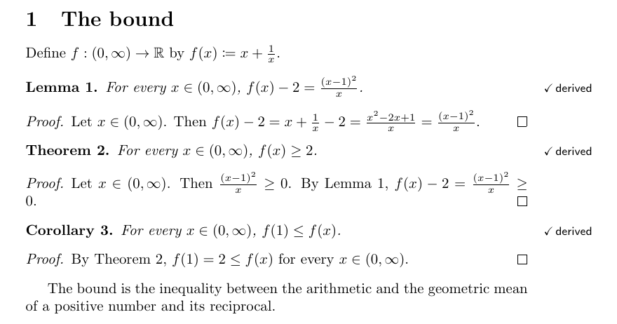
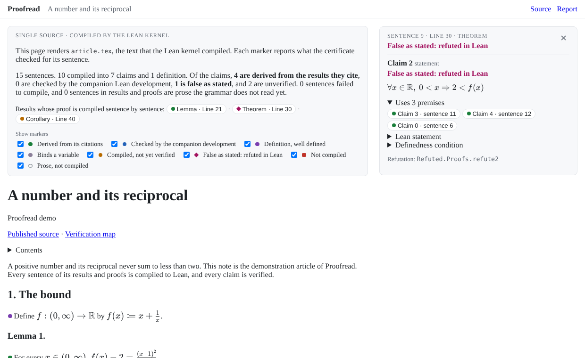

# Getting started: check an article with Proofread

Proofread reads a mathematical article in LaTeX, compiles every sentence it can
read to Lean, and asks Lean to check what the article says. The article stays an
ordinary `.tex` file that you typeset and submit as before.

This guide follows one short note from a first draft to a certificate. The
draft, [`examples/Demo/draft.tex`](../examples/Demo/draft.tex), contains four
mistakes of the kind that reach referees: a typo in a proof, a statement written
loosely, a definition that does not make sense everywhere it claims to, and a
theorem that is false as stated. Each is caught at a different step. The
finished note is [`examples/Demo/article.tex`](../examples/Demo/article.tex).

## What a certificate guarantees

When `lake build` accepts the certificate of an article,

* every symbol is defined in the article before it is used, and every compiled
  sentence has exactly one reading, which you can read (`--claims`, the web
  reader),
* the Lean statements are the readings of the very text in `article.tex` (its
  contents are pinned by a hash),
* every definition is well defined: no division by zero, no argument outside
  its domain,
* every verified claim is proved in Lean, using only the standard axioms,
* every claim the text derives (a proof step, or a result whose proof
  compiled) is proved from exactly what it rests on: the results it cites and
  the earlier steps of its proof, plus general mathematics from mathlib.

It does not check sentences the grammar does not read. Those are prose and are
reported: a sentence of a theorem without a reading is a warning, because that
part of the statement is not checked. Words the article does not define (a
*copula*, the *Lebesgue measure*) mean what the vocabulary says
([Vocabularies and models](vocabularies.md)). The readings themselves are
fixed by the grammar, so read them once to make sure they say what you mean.

## 1. Set up a project

Install Lean with [elan](https://github.com/leanprover/elan). Then create a
folder for the project with two files.

`lean-toolchain`:

```
leanprover/lean4:v4.34.0
```

`lakefile.toml`:

```toml
name = "mynote"

[[require]]
name = "proofread"
git = "https://github.com/Corrram/proofread.git"
rev = "main"   # or a commit, for a reproducible build
```

Then fetch Proofread and mathlib, with mathlib's compiled files:

```sh
lake update
```

The first `lake exe proofread` builds the checker (a few minutes, once).

## 2. Write the article

Put the article in a folder named after it, here `Note/article.tex`. The folder
name becomes the Lean namespace. Load the usual packages and `proofread.sty`
(copy it from `.lake/packages/proofread/tex/` next to the article):

```latex
\usepackage{amsmath,amssymb,amsthm,mathtools}
\usepackage{proofread}
```

Write as you always do, in the style of [Writing for Proofread](writing.md):
define every symbol before you use it, with `\coloneqq`, give every quantifier,
and cite what a proof step uses. Here is the body of the draft (copy
`examples/Demo/draft.tex` to `Note/article.tex` to follow along):

```latex
\section{The bound}

Define $f:\mathbb{R}\to\mathbb{R}$ by $f(x)\coloneqq x+\frac1x$.

\begin{lemma}\label{lem:identity}
For every $x\in(0,\infty)$, $f(x)-2=\frac{(x-1)^2}{x}$.
\end{lemma}

\begin{proof}
Let $x\in(0,\infty)$.
Then $f(x)-2=x+\frac1x-2=\frac{x^2-2x+1}{x}=\frac{(x-1)^2}{x}$.
\end{proof}

\begin{theorem}\label{thm:bound}
For every $x\in(0,\infty)$, $f(x)>2$.
\end{theorem}

\begin{proof}
Let $x\in(0,\infty)$.
Then $\frac{(x-1)^2}{x}\ge0$.
By Lemma~\ref{lem:identity}, $g(x)-2=\frac{(x-1)^2}{x}\ge0$.
\end{proof}

\begin{corollary}\label{cor:min}
The function $f$ attains its minimum on $(0,\infty)$ at $1$.
\end{corollary}

\begin{proof}
By Theorem~\ref{thm:bound}, $f(1)=2\le f(x)$ for every $x\in(0,\infty)$.
\end{proof}
```

## 3. Check while you write

```sh
lake exe proofread check Note/article.tex
```

The check runs in about a second and certifies nothing. It reads the article
the way the kernel will:

```
Note/article.tex:36:1: warning: sentence not compiled (undefined symbol: g); it asserts nothing checked
Note/article.tex:40:1: warning: corollary sentence without a mathematical reading: The function $f$ attains its minimum on $(0,\infty)$ at $1$.
Note/article.tex: 1 definitions, 5 claims
  text: 1 compiled, 0 failed, 5 prose (of 6)
  results: 2 compiled, 0 failed, 1 prose (of 3)
  proofs: 5 compiled, 1 failed, 0 prose (of 6)
  all: 8 compiled, 1 failed, 6 prose (of 15)
```

* **Line 36** uses `g`, which nothing defines. It is a typo for `f`.
* **Line 40** is the whole statement of the corollary, and the grammar has no
  reading of "attains its minimum on … at …". Unread, the corollary would assert
  nothing checked. Say it as an inequality:
  `For every $x\in(0,\infty)$, $f(1)\le f(x)$.`

With both fixed, `--claims` prints the reading of every claim. These readings
are what Lean will prove, so read them:

```
lake exe proofread check Note/article.tex --claims
Note/article.tex:18:1: info: defines f (f)
Note/article.tex:21:1: info: claim 0: \forall x\in \mathbb{R},\ 0<x\Rightarrow f(x)-2=\frac{{(x-1)}^{2}}{x}
Note/article.tex:26:1: info: claim 1: \forall x\in \mathbb{R},\ 0<x\Rightarrow f(x)-2=x+\frac{1}{x}-2\land x+\frac{1}{x}-2=\frac{{x}^{2}-2\,x+1}{x}\land \frac{{x}^{2}-2\,x+1}{x}=\frac{{(x-1)}^{2}}{x}
Note/article.tex:30:1: info: claim 2: \forall x\in \mathbb{R},\ 0<x\Rightarrow 2<f(x)
Note/article.tex:35:1: info: claim 3: \forall x\in \mathbb{R},\ 0<x\Rightarrow 0\le \frac{{(x-1)}^{2}}{x}
Note/article.tex:36:1: info: claim 4: \forall x\in \mathbb{R},\ 0<x\Rightarrow f(x)-2=\frac{{(x-1)}^{2}}{x}\land 0\le \frac{{(x-1)}^{2}}{x}
Note/article.tex:40:1: info: claim 5: \forall x\in \mathbb{R},\ 0<x\Rightarrow f(1)\le f(x)
Note/article.tex:44:1: info: claim 6: \forall x\in \mathbb{R},\ 0<x\Rightarrow f(1)=2\land 2\le f(x)
```

Every sentence of the results and proofs now has a reading. `--prose` also
lists the proof sentences the grammar does not read, and
`editors/vscode/tasks.json` shows all findings as squiggles in the `.tex` file.

## 4. Generate the Lean files

```sh
lake exe proofread init Note/article.tex
```

```
wrote Note/Compiled.lean
wrote Note/Article.lean
wrote Note/Proofs.lean
wrote Note/Certified.lean

1 definitions and 7 claims.
Add the library to lakefile.toml (once):

[[lean_lib]]
name = "Note"
srcDir = "."
globs = ["Note.+"]

then build the certificate with `lake build Note.Certified`.
```

The four files never need to be rewritten by hand except `Proofs.lean`:

| File | What it does |
| --- | --- |
| `Compiled.lean` | The kernel compiles `article.tex`, pinned by the hash of its contents. |
| `Article.lean` | Every definition and claim as ordinary Lean: `f`, `claimK`, `meaningfulK` (every term of claim `K` is defined) and `obligationK` (its premises imply it). |
| `Proofs.lean` | Your proofs. `init` writes a stub for each. |
| `Certified.lean` | The certificate. It also writes `article.proofread.json` and `article.proofread.tex`. |

Each stub states the claim, where it comes from and what it rests on:

```lean
/-- Claim 2, statement (theorem at line 30; premises: claim 3, claim 4, claim 0):
`\forall x\in \mathbb{R},\ 0<x\Rightarrow 2<f(x)` -/
theorem proof2 : obligation2 := by
  intro_premises
  refine ⟨by unfold meaningful2; definedness [], ?_⟩
  sorry
```

The theorem rests on the two steps of its proof (claims 3 and 4) and on the
lemma that the second step cites (claim 0). `intro_premises` makes them
hypotheses `c3`, `c4` and `c0`.

## 5. Build: the definitions must make sense

```sh
lake build Note.Certified
```

```
error: Note/Proofs.lean:23:35: unsolved goals
x✝ : ℝ
a✝ : x✝ = 0
⊢ False
```

Line 23 is the well-definedness of `f`. The draft defines `f` on all of
`\mathbb{R}`, so `\frac1x` has to make sense for every real `x`, including
`x = 0`, and Lean is asked to derive a contradiction from `x = 0`, which it
cannot. The article only ever uses `f` on positive numbers, so the definition
should say so:

```latex
Define $f:(0,\infty)\to\mathbb{R}$ by $f(x)\coloneqq x+\frac1x$.
```

After every edit of the article, update its pin and build again:

```sh
lake exe proofread prepare Note/article.tex --lean Note/Compiled.lean
lake build Note.Certified
```

```
info: Note/Certified.lean:12:0: claim 0 is not verified: its proof Note.Proofs.proof0 uses sorry
…
info: Note/Certified.lean:12:0: 7 claims: 0 derived in the text from their citations, 0 justified by companion proofs, 0 refuted, 7 unverified; 1 definitions well defined. Axioms: [propext, Classical.choice, Quot.sound]
```

The certificate is built, and it covers the definition only: a proof that
still uses `sorry` leaves its claim unverified. You can certify an article
while its proofs are being written.

## 6. Prove the claims

Replace each `sorry` by a proof. A proof step follows from what it rests on:

```lean
theorem proof4 : obligation4 := by
  intro_premises
  exact ⟨by unfold meaningful4; definedness [], fun x hx => ⟨c0 x hx, c3 x hx⟩⟩
```

`#proofread_certify` audits every claim the text derives: its proof may use its
premises, mathlib and the article, but no other result of yours. A proof step
that needs a lemma the sentence does not cite is rejected, so cite it in the
text.

The theorem resists:

```lean
theorem proof2 : obligation2 := by
  intro_premises
  refine ⟨by unfold meaningful2; definedness [], fun x hx => ?_⟩
  obtain ⟨h, h'⟩ := c4 x hx
  linarith
```

```
error: Note/Proofs.lean:49:2: linarith failed to find a contradiction
…
h : f x - 2 = (x - 1) ^ 2 / x
h' : 0 ≤ (x - 1) ^ 2 / x
a✝ : f x ≤ 2
⊢ False
```

The proof gives `f(x) - 2 ≥ 0`, and the theorem claims `f(x) > 2`. At `x = 1`
the two sides are equal, so the theorem is false as stated. Record that in Lean:

```lean
theorem refute2 : meaningful2 ∧ ¬ claim2 := by
  refine ⟨by unfold meaningful2; definedness [], fun h => ?_⟩
  have h1 := h 1 one_pos
  norm_num [f] at h1
```

```
info: Note/Certified.lean:12:0: claim 2 is false: Note.refuted2
info: Note/Certified.lean:12:0: claim 5 is not verified: it rests on claim 2, which is refuted
info: Note/Certified.lean:12:0: claim 6 is not verified: it rests on claim 2, which is refuted
info: Note/Certified.lean:12:0: 7 claims: 4 derived in the text from their citations, 0 justified by companion proofs, 1 refuted, 2 unverified; 1 definitions well defined. …
```

The corollary and its proof rest on the false theorem, so they are not
verified either, even though their own proofs are correct. The diagnostics, the
PDF and the web reader all show it:

```
python .lake/packages/proofread/scripts/proofread_diagnostics.py Note/article.proofread.json
Note/article.tex:30:1: error: statement (claim 2) is false as stated: refuted by Note.Proofs.refute2
Note/article.tex:40:1: warning: statement (claim 5) compiled but not verified: it rests on claim 2, which is refuted
Note/article.tex:44:1: warning: proof step (claim 6) compiled but not verified: it rests on claim 2, which is refuted
```

![The PDF with \usepackage[status]{proofread}: Lemma 1 is derived, Theorem 2 is marked false, Corollary 3 is compiled but not verified](images/demo-pdf-refuted.png)

## 7. Fix the statement

The theorem should say `$f(x)\ge2$`. After the edit, `prepare` and the
original proof of the theorem (with `refute2` removed):

```
info: Note/Certified.lean:12:0: 7 claims: 7 derived in the text from their citations, 0 justified by companion proofs, 0 refuted, 0 unverified; 1 definitions well defined. Axioms: [propext, Classical.choice, Quot.sound]
```

Every claim of the note is now derived in the text: each sentence of every proof
follows from what it cites, and each result from its proof.
[`examples/Demo/Proofs.lean`](../examples/Demo/Proofs.lean) has all the proofs.



## 8. Read and share the result

* **The PDF.** `\usepackage[status]{proofread}` puts the status of every
  labelled result in the margin (from `article.proofread.tex`):
  derived, checked, partly checked, compiled, or false. Without the option the
  typeset article is unchanged, which is what you submit.
* **The web reader.** It renders the article from its source with a marker at
  every sentence, and shows for each one its formal reading, Lean statement,
  premises and justification:

  ```sh
  npm ci --prefix .lake/packages/proofread
  node .lake/packages/proofread/reader/build.mjs Note/article.tex
  ```

  This writes `Note/article-reader/index.html`.

  

* **The diagnostics.** `proofread_diagnostics.py … --verified` exits with an
  error unless every compiled claim is verified, so it can gate CI.

## 9. Check in CI

```yaml
name: Proofread
on: [push, pull_request]
jobs:
  certify:
    runs-on: ubuntu-latest
    steps:
      - uses: actions/checkout@v4
      - uses: leanprover/lean-action@v1
        with:
          build: 'false'
          use-mathlib-cache: 'true'
      - run: lake build Note.Certified
      - run: python .lake/packages/proofread/scripts/proofread_diagnostics.py Note/article.proofread.json --verified
```

The build fails if the article changed without `prepare`, if a definition is
not well defined, or if a proof breaks. The last step fails if a claim is not
verified or is refuted.

## When something does not work

| You see | Do this |
| --- | --- |
| `sentence not compiled (undefined symbol: …)` | Define the symbol earlier, or fix the typo. |
| `… sentence without a mathematical reading` | Rephrase with a construction from [Writing for Proofread](writing.md). In a proof, prose is fine: it asserts nothing. |
| `the article changed after …` or a stale pin | `lake exe proofread prepare article.tex --lean Compiled.lean`, then build. |
| `unsolved goals` in `definedI` or `meaningfulK` | A term is not defined everywhere it is used. Restrict the domain, or give `definedness [h₁, …]` the facts it needs. |
| `claim K is derived in the text from its citations, but its justification … uses …` | The proof uses a result the sentence does not cite. Cite it in the text. |
| `linarith failed`, or any proof that will not close | Check the reading (`--claims`). If the claim is false, prove `refuteK`. |

For longer articles, `prepare --cache` splits the kernel's work by section
([From the `.tex` file to the certificate](pipeline.md)). Two research articles
compiled this way are listed in the [README](../README.md#exemplars).
